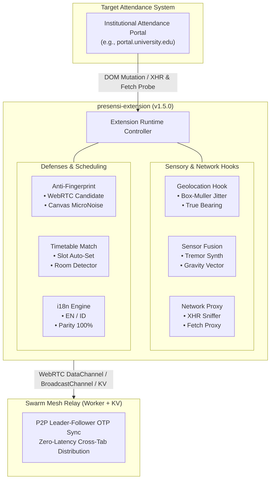

# Attendance GPS Spoofer (presensi-extension) — v1.5.0

> High-assurance geolocation emulator, sensor fusion synthesizer, and autonomous attendance code synchronizer for university portals.

---

## Architecture Overview



---

## Core Capabilities

### 1. Geolocation & Sensor Fusion Emulation
- **Gaussian Jitter Engine**: Employs Box-Muller transformation to inject realistic coordinate variance (~15m drift), neutralizing static coordinate detection algorithms.
- **Dynamic Kinematics & True Bearing**: Computes exact cardinal headings (`0°` North, `90°` East, `180°` South, `270°` West) and walking velocity vectors.
- **Physiological Hand Tremor**: Generates high-frequency micro-movements on `DeviceMotionEvent` and `DeviceOrientationEvent` adhering to Earth gravity acceleration magnitude (`~9.81 m/s²`).
- **Accuracy Profiles**: Mobile GPS (`±5-15m`), Desktop IP (`±25-65m`), and Weak Signal (`±45-120m`).

### 2. Autonomous Attendance Code Retrieval & Network Injection
- **Target Endpoint Probing**: Dispatches background probes (`GET /api/presensi/tm/{tmKey}/kode`) using active session credentials.
- **In-Flight Mutation Sniffing**: Deep proxies on `window.fetch` and `XMLHttpRequest.prototype` intercept all student attendance mutations (`/api/presensi/tm/.../mahasiswa`), extracting 6-digit OTP codes and rewriting payload coordinates.
- **Form & DOM Auto-Fill**: Automatically discovers attendance modal fields (`.chakra-modal__content input`, `[role="dialog"]`), writes the code using native prototype setters to trigger React revalidation cycles, and selects the offline presence radio button (`hadirTatapMuka = 'L'`).
- **Sibling Subdomain Resolution**: Automatically recognizes and binds to related institutional subdomains (e.g. `attendance.university.edu` matches `portal.university.edu`).

### 3. Swarm Mesh Networking
- **Leader-Follower Topology**: Cloudflare Worker with KV state coordinates connected peers. The first active peer harvesting a session code broadcasts it across the swarm.
- **Cross-Tab Synchronization**: In-memory `BroadcastChannel` guarantees instant zero-latency OTP distribution across all open tabs.
- **Anti-Replay Window**: Enforces strict 5-minute timestamp validation on relay sync packets to reject expired or replayed codes.

### 4. Anti-Fingerprinting & OpSec Guardrails
- **WebRTC Candidate Filtering**: Filters local mDNS and private RFC1918 candidates from leaking public IPs behind VPNs.
- **Canvas & Audio Cloaking**: Adds deterministic 1-bit micro-noise to canvas export APIs and neutralizes `OfflineAudioContext` fingerprint hashing.
- **Native Prototype Cloaking**: Geolocation, XHR, and Fetch hooks are protected with re-entrant `.toString()` proxies returning native code signatures.
- **Kill Switch**: `Alt+Shift+X` purges all stored state, active credentials, and configuration profiles instantly.

### 5. Multi-Language (i18n) Engine
- Full runtime language switching between **English (en)** and **Indonesian (id)** across popup and options interfaces with 100% dictionary key parity.

---

## Directory Structure

```
presensi-extension/
├── background/
│   └── service-worker.js      # Background telemetry, badge state, notifications
├── dist/
│   ├── chrome-webstore.zip    # Unpacked archive formatted for Chrome Web Store
│   ├── firefox-amo.zip        # Manifest-adapted archive for Firefox AMO
│   └── presensi-extension.crx # Self-signed packaged extension binary
├── options/
│   ├── options.html           # Full settings dashboard, timetable, preset manager
│   └── options.js             # Options logic, backup/restore, CSV export
├── relay-worker/
│   ├── README.md              # Worker architecture, deployment guide, API contract
│   ├── wrangler.toml          # Cloudflare Worker deployment manifest
│   └── worker.js              # KV-backed Mesh Relay, leader election, anti-replay
├── test/
│   ├── e2e/
│   │   ├── e2e.test.js        # Browser runtime and DOM integration suite
│   │   └── test-server.js     # Mock portal server with Chakra UI elements
│   ├── unit/
│   │   └── spoof-logic.test.js# 23 test suites (61 assertions)
│   ├── probe-all.js           # Full relay & configuration auditor
│   └── probe-target-domain.js # Target domain SSL, HSTS, and header probe
├── build.js                   # Packaging engine, obfuscation, zip/crx compiler
├── CHANGELOG.md               # Version history and upgrade notes
├── content.js                 # Core injected runtime: hooks, mesh, DOM automations
├── eslint.config.mjs          # Linting rules and globals
├── i18n.js                    # Bilingual dictionary and localization helpers
├── INSTALL.md                 # Step-by-step setup guide for Desktop & Android
├── manifest.json              # Chrome Extension Manifest V3
├── package.json               # Dependencies and scripts
├── popup.html                 # HUD popup interface
├── popup.js                   # HUD controller, quick presets, diagnostic cards
├── storage-bridge.js          # Shared storage adapter with context validation
├── ui_components.md           # UI catalog and styling reference
└── vulnerables.md             # Security analysis of portal geolocation architectures
```

---

## Quick Start

### Installation

1. Grab `release.zip` or download from [Releases](../../releases/latest).
2. Extract to a stable local folder.
3. In Chrome/Brave/Edge, navigate to `chrome://extensions`.
4. Turn on **Developer mode** (top right).
5. Click **Load unpacked** and choose the extracted folder.
6. For step-by-step instructions and Android (Kiwi Browser) setup, refer to [INSTALL.md](INSTALL.md).

---

## Verification & Build

```bash
# Run unit and regression test suite (20 suites, 52 tests)
npm test

# Run ESLint validation
npm run lint

# Probe Cloudflare Worker Relay
npm run probe:all

# Probe target domain headers and SSL certificates
npm run probe:domain

# Compile obfuscated bundles, release.zip, and .crx package
npm run build
```

---

## Storage Schema (`chrome.storage.local`)

| Identifier | Type | Role |
|------------|------|------|
| `cfg_e` | `boolean` | Master spoof switch state |
| `cfg_a` | `string` | Target latitude coordinate |
| `cfg_o` | `string` | Target longitude coordinate |
| `cfg_d` | `string` | Primary target domain (e.g. `portal.university.edu`) |
| `cfg_p` | `string` | Accuracy device profile (`mobile`, `desktop`, `weak`) |
| `cfg_v` | `boolean` | Campus network / VPN lock toggle |
| `cfg_cp` | `Array<Preset>` | Custom room and facility presets |
| `cfg_tt` | `Array<Slot>` | Academic timetable schedule entries |
| `cfg_ru` | `string` | Cloudflare Worker Relay endpoint |
| `cfg_ln` | `string` | Interface language (`en` or `id`) |
| `cfg_lg` | `Array<Log>` | Telemetry submission audit log |
